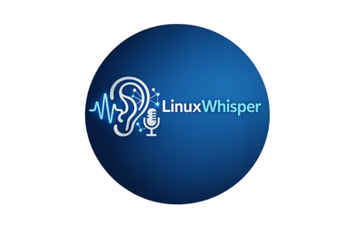
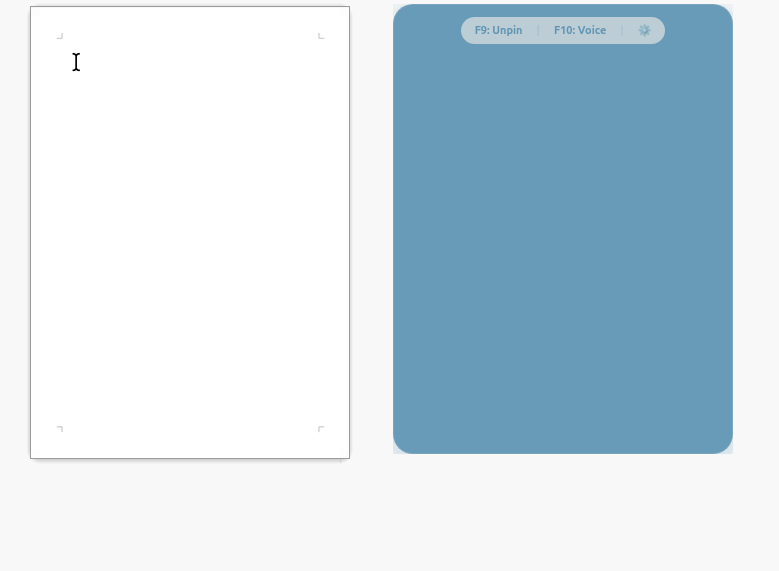

<div align="center">



# LinuxWhisper

**A Voice-Assistant & AI Companion for Linux**

[](https://www.python.org/)
[](LICENSE)
[](https://openrouter.ai)
[](https://groq.com)
[](https://deepgram.com)

---

**LinuxWhisper** is a simple voice assistant designed to help you with daily tasks. It uses global hotkeys to provide AI-powered tools without switching windows.

<br />



</div>

## Features

- 🎙️ **Dictation**: Voice-to-text at your cursor using **Deepgram Nova-3** (live streaming; the
  recording overlay shows the transcript while you speak, the finished text is inserted on release).
- 💬 **AI Chat**: Helpful Q&A and conversation on **OpenRouter** (`deepseek/deepseek-v4.1-flash`).
- ✍️ **Smart Rewrite**: Modify selected text using your voice.
- 👁️ **Vision**: Understand screenshots using **Qwen3.8** (`qwen/qwen3.8-27b` on Groq).
- 🔊 **Voice Feedback**: Optional text-to-speech for AI responses (toggle in the tray menu).

---

## 🖥️ Supported Platforms

| Distribution | Display Server | Status |
|:---|:---|:---|
| **Debian / Ubuntu** | X11 | ✅ Fully supported |
| **Debian / Ubuntu** | Wayland | ✅ Supported |
| **Fedora / RHEL** | X11 | ✅ Supported |
| **Fedora / RHEL** | Wayland | ✅ Supported |
| **Arch Linux** | X11 | ✅ Supported |
| **Arch Linux** | Wayland / **Hyprland** (Omarchy) | ✅ Supported |
| **Arch Linux** | Wayland / **Niri** | ✅ Fully supported |

The app auto-detects your session type (X11 or Wayland) and uses the appropriate backends:

| Feature | X11 | Wayland |
|:---|:---|:---|
| Clipboard | `xclip` | `wl-clipboard` |
| Key Simulation | `xdotool` | `wtype` |
| Screenshots | `gnome-screenshot` | `grim` |
| Overlays | GTK Window Hints | `gtk-layer-shell` |
| Global Hotkeys | `evdev` | `evdev` |

---

## ⌨️ Command Center

| Key | Action | Purpose | Backend / Model |
|:---:|:---|:---|:---|
| `F3` / R-Alt | **Dictate** | Transcribe voice to text at cursor | Deepgram `nova-3` (streaming, `language=multi`) |
| `F4` | **Chat** | Open/Focus AI conversation | OpenRouter or Groq — model selectable in settings |
| `F8` | **Vision** | Screenshot + Intelligent Analysis | Groq `qwen/qwen3.8-27b` |
| `F9` | **Rewrite** | Highlight text → Speak to modify | OpenRouter or Groq — model selectable in settings |

Chat and Rewrite default to OpenRouter `deepseek/deepseek-v4.1-flash`. Both can be switched to another
provider (*OpenRouter* or *Groq*) and to any model that provider offers — the settings dialog fetches the
provider's model list live. The choice lives in `settings.json` (`chat_provider`, `chat_model`,
`rewrite_provider`, `rewrite_model`).

Pinning the chat overlay and voice feedback have no hotkey — both live in the tray menu
(see the tip below). TTS uses Groq `canopylabs/orpheus-v1-english`.

---

## 🛠️ Quick Start

### 1. Requirements
*   **Linux** (Debian/Ubuntu, Fedora/RHEL or Arch Linux)
*   **OpenRouter API Key**: [openrouter.ai/keys](https://openrouter.ai/keys) — used by chat and
    rewrite while their provider is set to OpenRouter (default `deepseek/deepseek-v4.1-flash`)
*   **Groq API Key**: [Get your free key here](https://console.groq.com) — always needed for vision
    (`qwen/qwen3.8-27b`) and TTS, and for chat/rewrite when their provider is set to Groq
*   **Deepgram API Key**: [console.deepgram.com](https://console.deepgram.com) — dictation is transcribed by
    Deepgram's streaming API (`nova-3`, `language=multi`)
*   **User in `input` group** (for global hotkeys):
    ```bash
    sudo usermod -aG input $USER
    # Log out and back in after this
    ```

### 2. Installation
```bash
git clone https://github.com/Dianjeol/LinuxWhisper.git && cd LinuxWhisper
./setup.sh
```

The setup script automatically detects your distribution and session type, then installs the correct packages.

### 3. Launch
```bash
# Set your API Keys once
export OPENROUTER_API_KEY="your_key"
export GROQ_API_KEY="your_key"
export DEEPGRAM_API_KEY="your_key"

# Start the assistant
linuxwhisper

# Or alternatively:
python -m linuxwhisper
```

> [!TIP]
> Use the **System Tray** icon or the ⚙️ icon in the chat overlay to open the settings: TTS voice,
> **AI models** (provider + model for Chat/F4 and Rewrite/F9, loaded from the provider), color scheme
> and the hotkey list.
> **Pin Chat Overlay** (stay visible instead of auto-hiding) and **Voice Feedback (TTS)** are toggled in the
> tray menu — they no longer have hotkeys. Pinning is off by default, so the chat overlay hides itself again
> after a few seconds.

---

### Niri Users

For best overlay behaviour, add these rules to `~/.config/niri/config.kdl`:

```kdl
layer-rule {
    match namespace="linuxwhisper-recording"
    shadow { on false }
}

layer-rule {
    match namespace="linuxwhisper-chat"
    shadow { on false }
}
```

### Hyprland / Omarchy Users

No extra compositor rules needed — the overlays use `gtk-layer-shell`, which Hyprland supports natively.

---

## 📂 Project Structure

```
src/linuxwhisper/
├── __init__.py          # Package version
├── __main__.py          # python -m linuxwhisper
├── app.py               # main() entry point
├── config.py            # Config dataclass + CFG singleton
├── state.py             # AppState + SettingsManager + STATE
├── api.py               # Groq + OpenRouter client initialization
├── decorators.py        # safe_execute, run_on_main_thread
├── platform/
│   ├── __init__.py      # Session detection + backend factory
│   ├── base.py          # Abstract base classes (ABCs)
│   ├── x11.py           # X11 backends (xdotool, xclip, gnome-screenshot)
│   └── wayland.py       # Wayland backends (wtype, wl-clipboard, grim)
├── services/
│   ├── audio.py         # AudioService (recording + streaming to Deepgram)
│   ├── deepgram.py      # DeepgramLiveSession (live WebSocket transcription)
│   ├── ai.py            # AIService (chat + vision)
│   ├── tts.py           # TTSService (Orpheus voice)
│   ├── clipboard.py     # ClipboardService (uses platform backends)
│   └── image.py         # ImageService (uses platform backends)
├── managers/
│   ├── history.py       # HistoryManager (conversation + tray history)
│   ├── chat.py          # ChatManager (overlay state + auto-hide)
│   └── overlay.py       # OverlayManager (recording indicator)
├── ui/
│   ├── recording_overlay.py  # GtkOverlay (waveform + gtk-layer-shell)
│   ├── chat_overlay.py       # ChatOverlay (WebKit2 + gtk-layer-shell)
│   ├── settings_dialog.py    # SettingsDialog (voice, models, schemes, hotkeys)
│   └── tray.py               # TrayManager (AppIndicator)
└── handlers/
    ├── mode.py           # ModeHandler (dictation/AI/rewrite/vision)
    └── keyboard.py       # KeyboardHandler (evdev listener)
```
